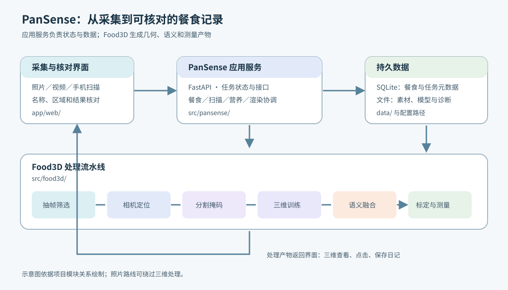
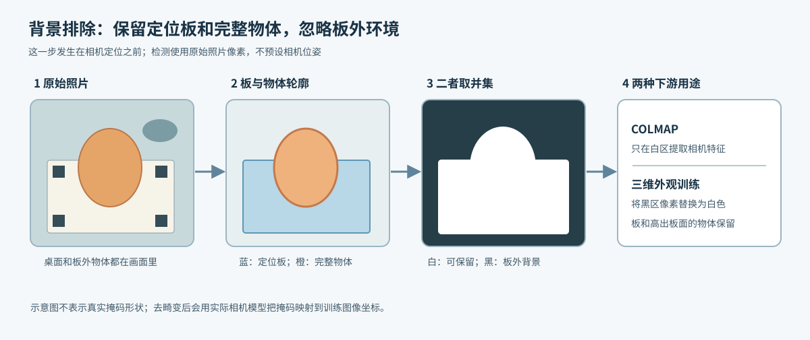
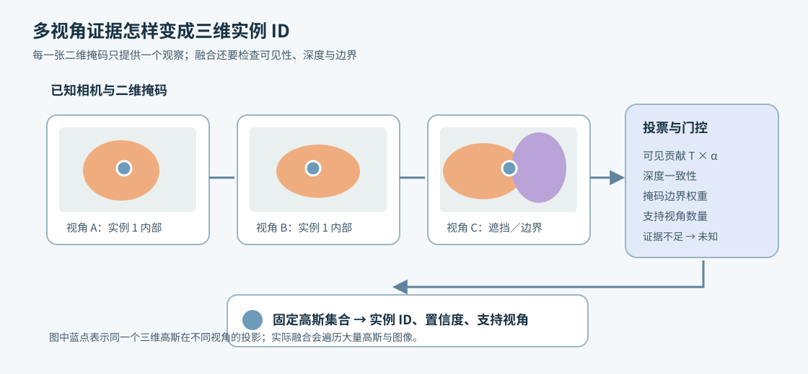
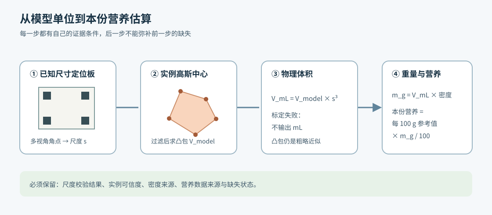

# PanSense 技术文档

> 版本依据：2026-10-18 的 `origin/main` 提交 `39fe4ac`。本文以该提交中已经接入的功能为准；本工作区还有未提交的算法修改，单独放在第 9 节说明。原先引用的多篇 `docs` 报告已从新版仓库移除，本文不再把它们当作当前文件引用。

## 1. 这个项目要解决什么问题

PanSense 是一个本地餐食记录应用。用户可以拍照、上传环绕视频，或用手机围绕餐盘拍摄一组照片。应用先让用户核对食物名称和区域，再把餐食保存到日记。视频和扫描照片还能生成一个可旋转的三维餐盘；点中其中的物体，可以查看其固定编号、名称，以及条件满足时的体积和营养估算。

以“一盘有两颗苹果和一根香蕉的食物”为例：如果只拍一张照片，系统能在照片上标出它们并保存清单，却看不到背面；如果围绕餐盘拍摄，系统先恢复各张照片的拍摄位置，再建立三维外观，最后把二维照片里的三件物体对应到三维模型。两颗苹果应保持两个不同的**实例 ID**，即使它们最终显示同一个食物名称。这个例子用于解释流程，不是某次实验的输入。

阅读下文前，记住几个词就够了：

- **视角**：从一个位置拍摄的一张照片。视频会抽成许多视角。
- **相机位姿**：拍摄该照片时相机的位置和朝向。
- **掩码**：图中属于某个物体的像素区域，比矩形框更贴近轮廓。
- **高斯**：构成三维外观的许多半透明椭球状元素。它们一起渲染成看到的餐盘。
- **实例 ID**：物体的身份编号。用户改名称时，编号可以保持不变。
- **bundle**：交给应用加载的三维结果目录，存放相机、高斯、实例语义和测量文件。

### 1.1 四条记录路线

| 页面入口 | 提供的材料 | 用户得到什么 |
|---|---|---|
| 照片记录 | 一张照片或相册图片 | 二维区域、可修改的食物清单和日记；没有本次新建的三维模型 |
| 三维记录 | 一段围绕静止餐盘拍摄的视频 | 相机重建、三维外观、可选的物体语义和体积估算 |
| 手机扫描 | 手机逐张拍摄、上传的照片 | 拍摄方向和质量反馈；提交后进入多视角重建 |
| 调整已有餐盘 | 已保存餐食或未保存草稿 | 查看原有营养、修改清单，或利用原素材生成新的识别版本 |

四条路线都在“记录”页。拍照、视频、扫描与调整已有餐盘是不同入口；首页和日记显示已保存的餐食，草稿不会直接计入摄入。[页面实现](../app/web/app.js)、[餐食存储](../src/pansense/store.py)。

对于已有餐盘，当前页面把两类动作分开：直接改食物清单时进入原餐食；重新运行图像识别时创建一份新草稿，原餐食保留。新草稿需要用户核对并保存。没有原照片的记录仍可调整文字清单，但无法凭空重新分割图像。[页面动作](../app/web/app.js)、[重新识别接口](../src/pansense/meal_semantics.py)。

### 1.2 单张照片怎样变成可编辑餐食

照片路线不会运行 COLMAP 或训练新的高斯。服务先校正照片的 EXIF 方向、统一为 RGB，并将识别用图像缩至最长边 960 像素。自动方式由 SAM 2 提出物体区域，CLIP 比较裁剪区域与候选食物文字的相似度；程序再按面积、分数差、画面边缘和区域重叠筛选候选。相似度和两个候选之间的分数差都不是“这一定是苹果”的概率，所以结果页仍要求用户核对。[照片识别](../src/pansense/photo.py)、[图文匹配](../src/food3d/segmentation/recognition.py)。

提示方式改变的是**怎样找到区域和名称**。食物清单限定希望留下的类别，但识别时仍把其他已知类别作为竞争候选，避免用户只写“面包”就把香蕉强判为面包；文字定位先由 Grounding DINO 找候选框，再用 SAM 2 细分；点击或框选直接把用户给的点或框交给 SAM 2，名称按用户输入保留；大模型方式先提出对象和位置，再由 SAM 2 生成实际掩码。选择不分割时，照片仍可保存，用户直接填写清单。[提示校验](../src/food3d/segmentation/hints.py)、[文字定位](../src/food3d/segmentation/grounding.py)、[点框分割](../src/food3d/segmentation/prompted.py)。

照片识别输出 `recognition.json`、每个实例的掩码和一张彩色叠加图。页面点照片时查对应掩码或人工框，点空白处返回背景；用户补充文字项不会自动产生新的视觉区域。独立的识别对比页允许同一张照片运行不同提示方式，每次生成独立结果；只有用户选择的结果才进入餐食草稿。[照片点击接口](../src/pansense/api.py)、[识别对比接口](../src/pansense/assistance_api.py)。

## 2. 系统由哪些部分组成



图 1：网页负责采集、核对和查看；PanSense 服务保存餐食、管理任务和提供接口；Food3D 处理照片、相机、掩码、三维模型与测量。照片记录只经过自己需要的步骤。背景排除是可选预处理，发生在相机定位之前。

网页文件在 `app/web/`。主界面由 HTML、CSS 和原生 JavaScript 组成，电脑上的日记与手机专用采集页有不同入口。PanSense 服务位于 `src/pansense/`，通过 FastAPI 提供上传、餐食、扫描、渲染和营养接口。SQLite 文件保存餐食及偏好；视频、照片和模型等大文件留在数据目录。Food3D 位于 `src/food3d/`，负责从多视角素材生成相机、掩码、高斯模型和测量结果。[应用入口](../src/pansense/api.py)、[任务编排](../src/pansense/jobs.py)。

一次视频任务在当前代码中的主要顺序是：

```text
视频或扫描照片
  → 抽帧／照片筛选
  → 可选：定位板与物体背景排除
  → COLMAP 相机定位
  → 物体识别和多视角掩码
  → Splatfacto 三维外观训练
  → 导出高斯模型
  → 定位板尺度标定（启用时）
  → 二维掩码与三维高斯融合
  → 一致性检查、体积估算
  → 用户核对并保存餐食
```

这是[当前任务代码](../src/pansense/jobs.py)的执行顺序。旧版文档把三维训练写在分割之前，容易让读者误以为所有模式都先训练后识别。手工点框模式是一个例外：它会先准备相机和一张固定参考帧，等用户标注后才继续分割与训练。“不使用语义分割”会跳过实例语义、融合和体积流程，只生成三维外观，食物清单由用户填写。

## 3. 从视频到三维餐盘

### 3.1 抽帧和拍摄质量

视频中相邻画面往往几乎一样，模糊画面也会妨碍后面的特征匹配。系统按配置从视频采样，再筛掉不清晰或与上一张保留画面过于相似的图像。采样清单 `frame_manifest.json` 记录每张候选图的实际视频时间、清晰度、是否保留及拒绝原因。因此“采样了多少张”和“最后有多少张参与相机定位”是不同数字。[抽帧实现](../src/food3d/data/frames.py)。

视频输入当前要求 3 秒至 3 分钟，上传大小上限 240 MB；照片上传上限 20 MB。任务会根据视频时长调整采样率，避免长视频只处理开头。当前视频场景配置最多取 120 张候选图，并要求最终至少注册 20 张相机视角。这些只是运行门槛：照片清晰、角度连续、相邻图像有重叠，仍是建立好模型的关键。[上传接口](../src/pansense/api.py)、[场景配置](../configs/fruit2_video.yaml)。

手机扫描将方向划成 12 个水平分段和 2 个高度带，共 24 格。每格需要足够清晰、视点不同且位姿可靠的照片，才会计入自动覆盖；手动选定的方向另行标记。方向图帮助用户补拍，不能保证食物底部或被遮挡的一面也被记录。[扫描几何](../src/pansense/scan_geometry.py)、[扫描会话](../src/pansense/scans.py)。

### 3.2 可选的背景排除



图 2：板外桌面和杂物容易提供大量稳定特征，使相机围着“背景”建立坐标。背景排除先做一张**前景允许区域**，再把它分别交给相机定位和三维外观训练。图中板上的物体高出纸面，所以不能只截取纸面四边形。

具体过程从原始照片开始，此时还没有 COLMAP 相机位姿：

1. **找定位板并筛帧。** 程序在每张已通过抽帧筛选的照片里检测 ArUco 标记，用标记在板上的已知位置与照片角点估计单应变换，从而画出定位板边界。这个二维步骤不需要先知道相机位置；至少要有 3 个可识别标记。没找到可靠板边界的照片退出后续重建，不会混入未遮罩的背景。若剩余照片不足任务要求的数量，任务报错。[板边界检测](../src/food3d/segmentation/board_scope.py)、[帧清单](../src/food3d/data/board_background.py)。
2. **找板上的完整物体。** 从保留照片中均匀挑关键帧，让所选视觉模型跨视角提出对象及框，并用板边界过滤明显在板外的候选；SAM 2 将框变成像素掩码，再把同一实例跟踪到其他照片。框的中心用于判断候选是否属于板上区域，但被保留物体的掩码不会在板边缘裁断，悬出板外或高于板面的部分仍可留下。模型给出的对象身份和名称仍需核对。[关键帧与识别](../src/food3d/segmentation/vision_llm.py)、[锚点与跟踪](../src/food3d/segmentation/llm_segment.py)。
3. **生成允许区域。** 对每张照片，先填满板的多边形，再与所有跟踪到的物体像素取并集，最后用 3 × 3 像素核略微膨胀，容纳边缘误差。用简式表示就是 `允许区域 = 膨胀(定位板区域 ∪ 物体区域)`。这里把不确定的前景重叠区域也保留；这张二值图只回答“此处是否可供重建使用”，不是给食物命名的最终实例掩码。[掩码组合](../src/food3d/data/board_background.py)。
4. **在两个阶段使用。** COLMAP 的特征提取读取原图和这张允许区域，只在允许区域内取匹配特征；原始照片本身此时仍保留。COLMAP 得到相机并去畸变后，程序按照其**实际原始相机模型**，将原像素网格上的允许区域映射到去畸变图像，生成板外为白色的新训练图。场景文件随后指向这些图，Splatfacto 据此学习板和物体的外观。[COLMAP 接入](../src/food3d/data/colmap.py)、[掩码去畸变与训练图](../src/food3d/data/board_background.py)。

举例说，一张图里板外的鼠标很清楚，板上苹果略模糊。如果直接用所有像素，相机匹配和三维训练都可能保留鼠标；开启背景排除后，鼠标位置在特征掩码中为黑，训练图中变白，而苹果即使有一部分高出板边也能保留。这仍要求板和物体始终相对静止：若固定相机、转动定位板，板与物体须一起转、停稳后拍。视觉模型漏掉物体、SAM 2 跟踪漂移、定位板被遮住，都会使可用信息变少；排除背景不会补出未拍到的背面。[处理报告](../src/food3d/data/board_background.py)。

要排错，可先看 `scene/board_background/debug/preview.jpg` 是否保留了完整物体，再看 `report.json` 的 `processed_frames`、`excluded_frames` 和每帧 `retained_fraction`。当前云端提交在 COLMAP 后仍按所选方式正式分割；背景阶段的掩码主要用于相机匹配与训练图。本工作区另有**未提交**的掩码复用代码，尝试将已跟踪的实例 ID 和置信度映射到去畸变图后直接用于正式分割，不能把这项本地尝试写成 `39fe4ac` 已交付功能。[本地复用实现](../src/food3d/segmentation/reuse_background.py)。

### 3.3 COLMAP 找相机

系统现在有一组照片，却还不知道每张照片从哪里拍摄。COLMAP 先在不同照片中寻找同一个视觉特征，例如定位板角点或桌面纹理，再利用它们在各张照片中的位置，估计相机的位置、朝向和少量三维点。输出的稀疏点云可以为下一步模型训练提供起点，但它不是完整的餐盘外形。[相机重建](../src/food3d/data/colmap.py)、[相机数据转换](../src/food3d/data/cameras.py)。

想象同一个黑色标记出现在三张照片里：它在每张照片中落点不同，但真实世界中只有一个位置。大量这样的对应关系共同约束相机。重复物体、低纹理、模糊和视角之间缺少重叠，都可能让特征对应错位。即使所有照片都注册成功，也还要检查重投影误差和相机轨迹。

COLMAP 得到的世界通常只有相对尺度。例如一个苹果宽 `0.2` 个模型单位，此时尚不知道它相当于多少厘米。真实尺寸要等定位板标定。[场景数据结构](../src/food3d/schemas.py)。

### 3.4 在照片中给物体分配身份

相机定位之后，系统用 SAM 2 等方法得到每个物体的二维掩码，再把同一物体的掩码传播到其他视角。食物名称有几种获取方式：用户写清单、输入目标名称、在固定参考帧点选或框选，或者让视觉大模型综合多个关键视角提出名称和实例。也可以选择“不使用语义分割”，只保存三维外观并手工维护清单。[分割入口](../src/food3d/cli.py)、[辅助识别说明](../app/ASSISTANCE.md)。

对于两颗苹果，系统应在整组照片中保持“苹果 A”和“苹果 B”各自的编号。CLIP 对候选名称的分数只是图文相似度参考；视觉大模型也可能把包装、非食物或相似水果认错。用户改名称时，不必改变已经可靠建立的实例 ID。点框标注的坐标始终对应准备阶段选定的参考帧，避免标在一张图上、实际却对另一张图运行分割。[点框准备与继续](../src/pansense/jobs.py)。

大模型方式会在若干关键视角中共同判断对象，再用 SAM 2 在这些视角生成锚点掩码，向前后传播到整组照片。若画面中有定位板，程序还会用板上标记估计纸面区域，过滤明显在板外的候选；保留下来的立体物体掩码仍包含高出纸面的完整轮廓。大模型可经配置的兼容视觉接口或已登录的本机 Agent 调用；选择这条路线时，关键视角图像会提交给相应模型服务，名称、类别和位置都需要人工复核。[多视角识别](../src/food3d/segmentation/llm_segment.py)、[定位板范围](../src/food3d/segmentation/board_scope.py)、[服务配置](../src/food3d/segmentation/vision_llm.py)。

### 3.5 Splatfacto 训练三维外观

COLMAP 的稀疏点像一个粗略草稿。Splatfacto 以这些点为起点，用大量三维高斯表示场景。每个高斯都有位置、尺度、朝向、透明度和颜色等参数；从某个相机位置渲染时，画面上的高斯按可见顺序混合颜色。

这里的“训练”是为**这一套餐盘**调整高斯参数。程序从已知相机角度渲染一张预测图，与真实照片比较，再调整高斯，重复许多次。SAM 2、CLIP 等识别模型在这里不会因上传一餐而重新训练。训练结束后导出应用能加载的 `gaussians.npz` 和 `gaussians.ply` 等文件。[训练入口](../src/food3d/reconstruction/train_worker.py)、[导出](../src/food3d/reconstruction/export.py)。

训练成功并不保证没有重影或缺面。判断质量时，应把实际拍摄视角的原图与渲染图并排看，并尝试转到未直接拍摄的方向。如果相机位置原本估错，延长高斯训练通常也无法修复这个根本问题。

### 3.6 把二维物体对应到三维高斯



图 3：蓝点是同一个三维高斯在不同照片里的投影。前两个视角较清楚地看到它属于同一个物体；第三个视角接近遮挡边缘，这张照片给出的证据较弱。

只拿一张照片的掩码给三维高斯贴标签，很容易把被遮挡的苹果算进前面的香蕉。系统会从多个相机视角检查某个高斯是否真的出现在画面中、投影落在哪个掩码里、是否被更近的表面挡住，再把各视角的证据累加。融合中用到 `T × α`，可以理解为这个高斯对最终像素颜色的实际可见贡献；边缘和深度检查进一步减弱不可靠的证据。[语义融合](../src/food3d/fusion/pipeline.py)。

默认至少需要 3 个支持视角。信息不足的高斯保持“未知”，不硬分配给某种食物。语义文件还保存它绑定的模型哈希。重新训练、清理或重新排序高斯后，旧语义文件就可能与新模型错位，需要重新融合；只改显示名称则不用重新训练。[语义投票](../src/food3d/fusion/voting.py)。

### 3.7 页面拖动和点击

网页让后端按新的相机角度渲染彩色图和实例信息。用户点击画面时，页面发送这张画面的令牌与归一化坐标，后端再查对应的实例 ID、当前名称和可用营养。编号 `0` 是背景，`65535` 是未知；这两类点击不会返回食物名称。改变视角后，可靠区域应继续指向同一个物体。[渲染与点击](../src/pansense/rendering.py)、[接口](../src/pansense/api.py)。

### 3.8 手机扫描怎样判断“这一圈拍够了”

手机扫描不是让用户盲拍 24 张。采集页与电脑上的扫描会话配对，每张照片上传后，服务检查中央区域是否模糊、曝光是否严重失常，并寻找定位板标记。积累至少 8 张角度不同且标记充足的照片后，程序尝试标定相机内参；之后利用板上已知角点估计每张照片相对板的位置。相机尺寸中途变化的照片会被拒绝，重复图片或过于相近的视角也不会凑数。[采集会话](../src/pansense/scans.py)、[相机与覆盖计算](../src/pansense/scan_geometry.py)。

方向图将一圈分成 12 个方位，每个方位再按拍摄高度分成两格。一个格子有两张清晰、位置有区别的照片才算在线阶段“已覆盖”；用户手动指出的方向单独显示，不冒充测得的相机位姿。结束扫描后，至少需要 20 张清晰且不重复的照片才会提交重建。COLMAP 完成后，系统只用**成功注册**的照片重新核算覆盖图；在线绿格可能因此减少。[覆盖校验](../src/pansense/scans.py)、[照片导入](../src/food3d/data/photos.py)。

### 3.9 已有模型怎样生成新的语义版本

用户从已有三维餐盘重新识别时，服务先确认参考照片确实来自这个模型的相机场景：检查素材路径、标准化照片哈希、参考帧和模型哈希。通过后，新的二维实例掩码沿原相机序列传播，语义投票应用到**复制出的高斯几何**，再检查点击一致性、沿用仍有效的定位板标定并重新计算体积。原模型和原餐食不被覆盖。大模型方式若已经得到可核对的多视角掩码，可复用这些掩码；其他方式从选定的参考掩码重新传播。[来源绑定与语义副本](../src/pansense/assistance_3d.py)。

这里省下的是重新训练三维外观的时间，并没有省掉二维区域与三维高斯对应的工作。单独上传的一张照片如果无法通过来源核验，就只有二维结果，不能借用另一餐看起来相似的模型。

## 4. 从三维餐盘到体积和营养



图 4：定位板给模型长度单位，三维实例给包围体积，食物密度把体积转成估计重量，营养目录再换算到本份。后面任何数字都依赖前面步骤的结果。

### 4.1 定位板把模型单位换成厘米

应用支持按原尺寸打印的 20 × 20 cm 或 A3 定位板，板上是可识别的 ArUco 方形标记，标记边长 3 cm。系统在多个已注册视角里检测同一标记的角点，利用相机求出这些角点的三维位置，再与已知纸面布局对齐。当前校验至少需要 3 个标记、12 个有效角点和 6 个视角，并检查重投影误差与边长是否一致。校验失败就不显示 mL。[标定代码](../src/food3d/board_scale.py)、[使用说明](../app/PAPER_VOLUME.md)。

若标定结果是“1 个模型单位 = 20 cm”，某物体在模型中占 `0.01 模型单位³`，换算后就是 `0.01 × 20³ = 80 cm³ = 80 mL`。这是演示算式，不是苹果的测量结果。长度误差会以三次方影响体积，因此系统不应在没有可靠标定时猜测 mL。

### 4.2 凸包体积是什么

系统从某个实例中挑出语义置信度、支持视角和透明度足够的高斯中心，删除重复点与孤立点，然后求能包住这些点的凸形外壳。点少于 16 个或几何退化时返回无法估算。想象用一层拉紧的薄膜包住外侧的点：香蕉弯曲处的空隙也会被薄膜跨过去，所以凸包是外形包围体积的粗估。[体积代码](../src/food3d/volume.py)。

未拍到的底部、漏掉的掩码、离群点和凹陷都会影响结果。包装外形包含空气，不能直接当作包装内可食部分的体积。

### 4.3 密度、重量与本份营养

有了 mL，还需知道食品密度，才能估计克数：`估计重量 g = 体积 mL × 密度 g/mL`。密度优先取用户手动选择或填写的值，其次取食品专属参考；没有专属参考时使用分类默认估值。若示例体积为 `80 mL`、密度参考为 `0.8 g/mL`，就得到 `64 g`。再假设某食品资料写“每 100 g 为 100 kcal”，这一份就是 `64 kcal`。以上只是说明怎么算，不是某种食物的推荐数值。[密度换算](../src/pansense/quantities.py)、[密度资料](../app/catalog/densities.json)。

当前食物目录有 700 项，其中一部分只有名称和识别词，没有已核对的完整营养数据。目录缺项时，后台可按食品名称查 USDA FoodData Central 和 Open Food Facts；联网查询只发送名称，不发送餐食照片或备注。若名称不精确、版本不唯一或查不到所需字段，营养仍显示待补充。包装外形和非食物不自动换算可食部分的重量与营养。[食品目录](../app/catalog/foods.json)、[后台查询](../src/pansense/nutrition_lookup.py)。

目录匹配、联网查询和本份换算是三步不同的事：先找名称对应的食品及每 100 g 资料，再检查资料是否完整、是否出现多个营养差异明显的候选，最后才乘以估计重量。后台查询会保存查询状态，服务重启打断的查询可重试；同名商品或菜谱有不同配方时，程序不会任意选一条来填营养值。[食品索引](../src/food3d/food_catalog.py)、[查询状态](../src/pansense/nutrition_lookup.py)。

单张照片或手工清单没有本次三维体积时，应用可显示目录参考份量，并注明未称重；三维记录缺少可靠标定、密度或营养参考时，本份数值保持未知，不当成零营养计入完整汇总。

### 4.4 仓库里还有哪些体积研究路线

日记应用当前使用的是“定位板尺度 + 语义高斯中心凸包”。仓库另有**实验性**的视觉外壳估算：把三维空间划成小体素，将每个体素投影到多张实例掩码，逐步排除不可能属于物体的空间；遮挡感知版本不会因为某张图里物体被挡住，就把那条射线当作空白。体素大小、视角数和掩码误差都会改变结果。[视觉外壳实现](../src/food3d/silhouette_volume.py)。

另一个照片数量实验从新拍的照片和板上角点重新估计相机，再运行多视角掩码与视觉外壳；还有只利用二维板面映射、用形状先验猜高度的对照。后一种方法没有测到真实高度，不能把先验范围当作物理误差条。这些研究脚本没有接入日记的正式体积字段，也没有实物体积真值来证明哪一种更准。[仅照片实验](../src/food3d/photos_only_volume.py)、[照片数量研究](../src/food3d/photo_count_study.py)。

Food3D 命令还保留旧纸片尺度标定和人工输入实测跨度的兼容入口，供旧 bundle 或独立实验使用；新餐食任务采用定位板。不同标定方法不能只看输出数字大小来比较优劣，还需核对同一模型、同一物体及实测参照。[旧纸片标定](../src/food3d/paper_scale.py)、[凸包与手工跨度](../src/food3d/volume.py)。

## 5. 文件、坐标和数据怎样对应

应用默认把餐食元数据保存在 `data/pansense/pansense.sqlite3`，把原始素材和一次次分析产物放在 `data/pansense/uploads/`。实际资源根目录可在 `configs/paths.json` 中调整。一次多视角分析通常类似下面这样，不同任务未必拥有所有文件夹：[存储](../src/pansense/store.py)、[任务](../src/pansense/jobs.py)。

```text
data/pansense/
├─ pansense.sqlite3
└─ uploads/<餐食 ID>/
   ├─ source.mp4 或 source.jpg       上传素材
   └─ analysis_<运行 ID>/
      ├─ analysis.log                 阶段和错误日志
      ├─ config.yaml                  本次场景配置快照
      ├─ scene/                      抽帧、相机和稀疏点
      ├─ segmentation/               各视角实例掩码
      ├─ training/                   三维训练检查点
      ├─ evaluation/                 三维语义检查
      └─ bundle/                     应用读取的三维结果
         ├─ scene.json
         ├─ model.json
         ├─ gaussians.npz
         ├─ semantics/
         └─ measurements/
```

`scene.json` 描述图像、相机和三维坐标关系；`gaussians.npz` 保存高斯外观；`semantics/semantics.npz` 对应每个高斯的实例 ID；`measurements/` 保存体积与可用标定。A 餐的语义文件不能随意配 B 餐的高斯：高斯顺序和实例身份都可能不同，所以模型、相机和语义结果需要来源与哈希校验。[场景结构](../src/food3d/schemas.py)、[模型读取](../src/food3d/reconstruction/gaussians.py)。

项目内部把去畸变图像左上角像素中心记作 `(0, 0)`；相机坐标 +X 向右、+Y 向下、+Z 向前；深度取相机方向 Z。COLMAP 与三维训练工具的图像中心和相机轴约定不同，导入导出时会转换。普通使用者不用手动计算这些值；开发新分割、相机或渲染模块时必须沿用同一约定，否则掩码会与三维投影错开。[相机转换](../src/food3d/data/cameras.py)、[场景校验](../src/food3d/schemas.py)。

用户导出的 JSON 是餐食记录与偏好，不含照片、视频和模型；如果要完整备份，需连同相应资产目录保存。网页离线缓存主要是界面外壳，日记与分析依赖本地服务。[隐私导出接口](../src/pansense/api.py)。

餐食记录在 SQLite 中有独立 ID 和递增的 `revision`。一次修改必须带上页面读到的版本号；若另一操作已经更新这餐，服务拒绝旧版本提交。服务读取餐食时再结合当前目录、密度资料和已有测量产物生成显示用的营养与重量，不把每次计算结果都视为不可变的历史事实。日记按用户设置的时区归档，只统计明确保存的记录。[事务与版本](../src/pansense/store.py)、[份量计算](../src/pansense/quantities.py)。

删除单餐会清理该餐的上传资产；“删除全部”会清理餐食、扫描会话并重置偏好。若关闭“保留照片和三维资产”，保存后会删除本次素材、掩码与模型，只保留文字和营养，之后也无法靠这些已删除素材重新分割。需要长期留存完整模型时，应同时备份数据库和对应资产目录。[删除与导出](../src/pansense/api.py)。

## 6. 一餐在服务中的状态

新素材上传后，服务先建立草稿并记录素材路径，再排队运行较耗时的分析。页面显示准备、识别、训练、融合等阶段。分析完成后用户核对名称、区域和营养，再明确保存进日记。中途失败时，原始素材及已完成清单仍可用于重试或手工记录；中断的训练不会从停止步数续跑。[任务状态](../src/pansense/jobs.py)。

| 页面动作 | 对应接口举例 | 结果 |
|---|---|---|
| 上传照片或视频 | `POST /api/meals/upload` | 建草稿、保存素材并启动相应分析 |
| 开始已准备的视频 | `POST /api/meals/{id}/video-start` | 继续使用固定参考帧和已有相机 |
| 重新识别已有餐食 | `POST /api/meals/{id}/recognize` | 创建新草稿，保留旧餐食 |
| 中断或重试 | `POST /api/meals/{id}/interrupt`、`/retry` | 更新任务状态并保留可复用输入 |
| 查看、点击和保存 | `POST /api/meals/{id}/view`、`/pick`、`/save` | 读取实例并确认日记记录 |

接口请求中含餐食版本号 `revision` 的操作会检查是否有人先改过这餐；版本已变化时返回冲突，避免旧页面的修改覆盖新记录。完整字段可以在运行中的 `/docs` 查看，也可以直接读[API 定义](../src/pansense/api.py)。

耗时分析由任务队列执行，任务阶段和错误写回餐食记录，同时把子命令输出留在 `analysis.log`。识别、训练和渲染共用一把资源锁，避免多个重任务同时争抢；中断会停止正在运行的子进程。服务重启后，未完成任务会标记为中断，用户可以重新分析，但训练不会从上次的迭代数继续。为了避免迟到的后台结果覆盖用户已经手动改过或保存的清单，发布结果前还会检查当前记录状态。[任务调度](../src/pansense/jobs.py)。

网页是一套无需构建步骤的 HTML、CSS 和 JavaScript，并提供 PWA 安装入口。Service Worker 只缓存页面、样式、脚本和图标；餐食 API、照片与三维画面不写入离线缓存。离线时能打开界面外壳，查看日记或运行识别仍需服务。服务还校验访问主机、拒绝其他网站来源的写入请求，文件接口只读取允许的数据目录。[网页入口](../app/web/index.html)、[离线缓存](../app/web/sw.js)、[服务限制](../src/pansense/api.py)。

### 当前示例入口的实际状态

主界面和识别对比页有“参考照片”“已有三维示例”等入口，但示例素材并不随 Git 代码一起提供。当前接入的参考照片接口仍读取固定的旧实验路径；文件缺失时会返回不可用提示。`src/pansense/examples.py` 已新增从本地餐食查找可用示例的函数，但在提交 `39fe4ac` 中还没有接入这些接口。新读者最好先上传自己的照片；文档不能保证点击“已有示例”就能打开模型。[当前接口](../src/pansense/meal_semantics.py)、[示例查找代码](../src/pansense/examples.py)。

## 7. 部署与复现：计算平台、环境和路径

### 7.1 GPU 运行需要准备什么

三维训练、SAM 2 分割和高斯渲染需要可被对应 PyTorch 环境识别的 NVIDIA GPU。先安装与所用 CUDA 版 PyTorch 兼容的显卡驱动，再用 `nvidia-smi` 确认设备、驱动和空闲显存。`nvidia-smi` 看到显卡只是第一关：两套 Python 环境都需要分别通过 `torch.cuda.is_available()`，高斯渲染还需通过下文的 `gpu_smoke.py`。[训练入口](../src/food3d/reconstruction/train_worker.py)、[GPU 检查](../tools/gpu_smoke.py)。

项目分开安装两套环境，因为识别与重建使用不同的 PyTorch/CUDA 组合。下面列的是仓库保存的**一组已用依赖版本**，供复现时核对；读者应以实际安装环境的兼容性检查为准，不需要使用某一种显卡型号：[环境记录](../environments/README.md)、[版本约束](../environments)。

| 环境 | 负责的工作 | 仓库记录的版本组合 |
|---|---|---|
| `.venv` | COLMAP/pycolmap、SAM 2、CLIP 和文字定位 | Python 3.13.3；PyTorch 2.11.0 + cu128；pycolmap 4.2.1 |
| `.venv-gs` | 应用服务、Splatfacto、gsplat 融合与渲染 | Python 3.10.20；PyTorch 2.4.0 + cu124；Nerfstudio 1.1.5；gsplat 1.4.0 + pt24cu124 |

Windows 环境记录中的 gsplat 使用预编译 wheel，当时不要求单独安装 CUDA Toolkit 或编译工具。仓库的 [`setup_windows.ps1`](../tools/setup_windows.ps1) 会建立环境、安装依赖并获取 SAM 2 源码与权重，但它**尚未在一台全新机器上完整验收**，并且要求工程内先有 `.tools/uv/uv.exe`、可用网络和足够磁盘空间。SAM 2 安装脚本获取的是上游 `main`，不能把历史安装记录当成永久锁定的依赖快照。

不同显卡和驱动可以对应不同的可用 wheel 组合。部署时先确认两套环境各自能识别 CUDA，再执行渲染烟雾测试和一份真实任务；不要用某台开发机的型号、显存或耗时作为最低要求。仓库目前没有经过验收的 Linux 一键安装脚本。[资源目录配置](../configs/paths.json)。

### 7.2 安装后逐层检查

Windows 在工程根目录的 PowerShell 执行；`project_paths.ps1` 会读取 `configs/paths.json` 并设置两个 Python 路径：

```powershell
. ./tools/project_paths.ps1
nvidia-smi
& $recognitionPythonExe -c 'import torch; print(torch.__version__, torch.version.cuda, torch.cuda.is_available())'
& $gsPython -c 'import torch; print(torch.__version__, torch.version.cuda, torch.cuda.is_available())'
& $recognitionPythonExe -m food3d doctor
& $gsPython -m food3d doctor
& $gsPython tools/gpu_smoke.py
```

Linux 如按 `configs/paths.json` 的默认目录建立环境，可用对应路径检查：

```bash
nvidia-smi
.venv/bin/python -c 'import torch; print(torch.__version__, torch.version.cuda, torch.cuda.is_available())'
.venv-gs/bin/python -c 'import torch; print(torch.__version__, torch.version.cuda, torch.cuda.is_available())'
PYTHONPATH=src .venv-gs/bin/python tools/gpu_smoke.py
```

`doctor` 只列出环境和外部工具，不会替你运行三维任务；`gpu_smoke.py` 真正调用 gsplat 渲染两个高斯，检查前后遮挡以及像素透明度与融合贡献是否一致，并将结果写入 `data/outputs/gpu_smoke.json`（若文件已存在会覆盖）。两套 PyTorch 检查都返回 `True`、smoke 显示 `status: passed` 后，再用独立输入目录运行一次真实任务；GPU 可见或烟雾测试通过都不等于真实场景已经重建成功。[环境诊断](../src/food3d/doctor.py)、[烟雾测试](../tools/gpu_smoke.py)。

### 7.3 启动应用与手机采集

Windows 在工程根目录运行：

```powershell
& tools/start_app.ps1
```

Linux 先复制两份配置，再按本机工具路径修改副本：

```bash
cp configs/pansense.yaml configs/pansense_local.yaml
cp configs/fruit2_video.yaml configs/fruit2_video_local.yaml
```

把 `pansense_local.yaml` 的 `scene_config` 指向 `configs/fruit2_video_local.yaml`；把场景配置中 `frames.ffmpeg`、`frames.ffprobe` 改为本机命令（例如 PATH 上的 `ffmpeg` 和 `ffprobe`）。按 pycolmap 的实际安装能力选择 `colmap.use_gpu` 和 `matching_use_gpu`；相机特征处理是否用 GPU 不决定后续 Splatfacto 能否使用 GPU。然后启动：

```bash
PANSENSE_CONFIG=configs/pansense_local.yaml .venv-gs/bin/python -m pansense --port 8000
```

这里的 `*_local.yaml` 是读者自行创建的配置副本，不是仓库已提交文件。实际应用和场景参数分别参考[应用配置](../configs/pansense.yaml)与[场景配置](../configs/fruit2_video.yaml)；不要直接沿用另一平台的工具路径。

启动后访问 `http://127.0.0.1:8000/`。手机采集需要另行开启局域网 HTTPS 网关并按页面说明完成配对和证书信任；Windows 可使用 `tools/start_mobile.ps1`。主餐食服务仍只绑定本机地址。[服务入口](../src/pansense/__main__.py)、[手机网关](../src/pansense/mobile_https.py)。

这里讲的是**单机 GPU 部署**。仓库没有现成的公网 GPU 服务、容器编排、多用户账户或云端数据同步方案；把服务放到远端机器还需要另行设计访问控制、存储和证书，不能仅将本地监听地址改成公网地址就视为已部署。

手机配对时，电脑为扫描会话生成随机令牌，二维码把会话 ID 与令牌交给手机；服务只保存令牌哈希，手机上传照片时用令牌验证。网关为手机采集页建立本地 HTTPS 证书，浏览器需要先信任相应证书。网关只开放扫描采集接口，不直接把完整餐食服务发布到局域网。[配对会话](../src/pansense/scans.py)、[采集接口](../src/pansense/scan_api.py)。

### 7.4 显存不足与结果复现

应用把耗时识别、训练和渲染任务串行使用同一设备，但其他进程仍可能占用显存。若发生显存不足，先关闭其他训练或演示进程；融合阶段可调低应用配置中的 `fusion_width`，输入图像过大时可在场景配置中调低 `frames.max_long_edge`，然后用**新分析目录**重试。这些调整会改变语义投票分辨率或训练输入，可能影响细小物体与画质。减少训练迭代数主要改变耗时和收敛程度，不能当作必然降低峰值显存的方法。[应用配置](../configs/pansense.yaml)、[场景配置](../configs/fruit2_video.yaml)、[任务资源锁](../src/pansense/jobs.py)。

当前已提交的 [应用配置](../configs/pansense.yaml)训练 3000 步；其他配置和旧实验可能使用不同步数，不能与默认流程混为一谈。复现某次结果，应保留输入文件、代码提交、`PANSENSE_CONFIG`、任务生成的 `config.yaml`、两套环境的包版本和独立输出目录。

本次工作区检查时，`.venv-gs` 没有安装 `pytest`，因此新增的 Python 页面流程测试尚未在这里运行。要复现测试，应先按环境记录补齐测试依赖，再使用同一代码版本运行。

从一份新任务检查结果时，按顺序看：

1. `scene/frame_manifest.json`：视频是否采到末尾，哪些帧因质量被丢弃。
2. `scene/colmap_selection.json`、`scene/validation.json`：相机注册了多少张，几何检查是否通过。
3. `segmentation/`：两颗相似物体是否跨视角保持两个 ID。
4. `training/` 和 `bundle/`：训练是否完成，原照片与对应角度的渲染是否接近。
5. `bundle/semantics/fusion.json`、`evaluation/report.json`：投票视角、未知区域及点击一致性。
6. `bundle/measurements/`：定位板校验、体积单位、密度与营养来源。

具体逐模块命令由 [Food3D CLI](../src/food3d/cli.py) 定义，项目还提供 [视频包装脚本](../tools/run_video.ps1) 和 [三维演示脚本](../tools/start_demo.ps1)。新结果应写到新的目录，不要覆盖已有模型或拿旧掩码套新相机。

## 8. 实验结果应该怎样读

当前仓库的 `docs/` 中已经没有旧版的水果1、水果2、视角数量和大模型体积实验报告，相关原始素材与输出也未纳入这次代码提交。旧报告还可以从提交 `b1f33c0` 的 Git 历史读取，例如：

```bash
git show b1f33c0:docs/fruit2_validation.md
git show b1f33c0:docs/view_count_comparison.md
```

这些是**历史记录**，不是对当前 `39fe4ac` 工作树的重新验收。旧水果2报告记录了 104 张注册视角和 31/32 次采样食物点击；旧视角对比中，5 张、10 张在那组素材上无法独立完成 COLMAP，而 30 张成功。这些结果都依赖当时的素材与配置。语义 IoU 以 SAM 2 掩码为参照，表示两套区域是否重合，不是人工标注的食物分类准确率；点击次数也只覆盖报告中的采样位置。[当前评估实现](../src/food3d/evaluation.py)。

当前评估程序把一部分相机视角留出，不参与三维语义投票；它在这些视角渲染新图，与对应的 SAM 2 掩码比较实例 IoU，并在掩码内部取代表点测试点击 ID。PSNR 比较原图与渲染图的像素误差，更多反映外观重现，不保证食物形状准确。留出视角仍参与相机重建和二维掩码传播，所以这是一项**语义投票的一致性检查**，不能称为完全独立的数据集验证。[评估代码](../src/food3d/evaluation.py)。

仓库还保留合成场景、相机和路径检查、不同视角数比较，以及依照语义证据清除少量背景漂浮高斯的工具。这些主要用于排错或实验：清理高斯会改变模型哈希，随后必须重新融合语义；少视角实验必须分清“从少量照片独立重建”和“借用完整相机轨迹只比较训练视角”两种问题。[场景检查](../src/food3d/doctor.py)、[视角比较脚本](../tools/compare_view_counts.py)、[背景高斯清理](../src/food3d/reconstruction/cleanup.py)。

项目最初的 Food3D 演示还可用 Gradio 单独打开 bundle，查看拖动与点击；它是算法结果检查入口，餐食记录则走 PanSense 网页。另有按语义掩码过滤相机匹配的研究工具，用来分析桌面纹理或背景干扰，而不是每次应用任务默认运行的步骤。[独立演示](../src/food3d/viewer/app.py)、[匹配过滤](../src/food3d/data/match_filter.py)。

定位板的[现存说明](../app/PAPER_VOLUME.md)记录过一组 91 张实拍图的几何标定，但它只检查尺度是否与板一致，没有测得物体的真实体积。要报告“体积误差是多少”，仍需有实物体积、重量及人工实例标注的数据。

本次核对还发现两个尚未收敛的地方：

- 新增的 [本地示例查找测试](../tests/pansense/test_record_workflow.py) 预期 `/api/recognition/examples` 可用，但 `39fe4ac` 的接口代码还未注册该路由。这组 Python 测试因测试依赖缺失而未运行；环境情况见第 7 节。
- 新增的 [页面流程测试](../tests/web/record-workflow.test.cjs) 在当前工作树执行 `node --test tests/web/record-workflow.test.cjs`，结果为 **0/7 通过**；失败集中在记录页返回路径、示例/三维回退和文案行为。文档因此只描述代码中已经能确认的处理路径，不把这些测试目标写成已验收功能。

## 9. 当前工作区与云端提交的区别

本工作区在 `39fe4ac` 之外还有未提交修改，涉及资源路径、背景处理、识别掩码复用和任务配置等。其中 [`reuse_background.py`](../src/food3d/segmentation/reuse_background.py) 是本地新增的算法文件。本文的主流程按已提交代码描述；第 3.2 节注明掩码复用的本地状态，第 7 节给出不依赖某台机器的部署检查步骤。将来若提交这些改动，应重新核对任务顺序、产物路径和验证结果。

## 10. 继续读哪里

| 想了解的问题 | 当前仓库中的入口 |
|---|---|
| 界面如何记录、纠错和保存 | [网页主流程](../app/web/app.js)、[应用说明](../app/README.md) |
| 单张照片与四种辅助识别 | [照片识别](../src/pansense/photo.py)、[提示输入](../src/food3d/segmentation/hints.py)、[识别对比接口](../src/pansense/assistance_api.py) |
| 上传、餐食状态与任务队列 | [应用 API](../src/pansense/api.py)、[任务编排](../src/pansense/jobs.py)、[SQLite 存储](../src/pansense/store.py) |
| 抽帧、相机、分割与三维训练 | [Food3D 命令入口](../src/food3d/cli.py)、[COLMAP](../src/food3d/data/colmap.py)、[分割目录](../src/food3d/segmentation)、[重建目录](../src/food3d/reconstruction) |
| 已有模型的来源核验与语义副本 | [模型绑定与副本](../src/pansense/assistance_3d.py)、[餐食重新识别](../src/pansense/meal_semantics.py) |
| 定位板、体积、密度和营养 | [标定说明](../app/PAPER_VOLUME.md)、[体积代码](../src/food3d/volume.py)、[营养与密度说明](../app/ASSISTANCE.md) |
| 扫描采集与配对 | [扫描接口](../src/pansense/scan_api.py)、[方向与定位板](../src/pansense/scan_geometry.py) |
| 质量检查与实验性算法 | [评估程序](../src/food3d/evaluation.py)、[视觉外壳](../src/food3d/silhouette_volume.py)、[照片数量实验](../src/food3d/photo_count_study.py) |
| 依赖及安装 | [环境记录](../environments/README.md)、[路径配置](../configs/paths.json) |
